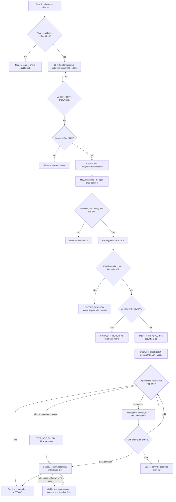

# Phase1 design review — round2 C0 resting bracket

[ASSUMED] DESIGN ONLY, not Phase2 or a release. Mayur's strategy definition supersedes the old three-bar-range setup wherever different. Round1 following-close primary fills, receipt-based cutoff and top100 initial pool are SUPERSEDED.
[READ_CODE] Source main79a2d3086c8aea660dc31068e2758db1f7332808 reread for detector/qualifier/scanner/choice guard. Historical CI evidence remains separate from local UNKNOWN baseline. Actual Render state **unverifiable by Codex**; no deployment/config/cron change.
[ASSUMED] Single proposed Phase2 application foundation: origin/main containing PR14 HumanChoicePaperLedger; PR13/15 remain open/reference-only. No merge/cherry-pick/closure. Mayur supplies clean checkout; baseline verification and explicit Phase1 approval precede Phase2.

## Authoritative strategy and review map

[ASSUMED: Mayur strategy] C0.close strictly exceeds highest prior3highs; qualify only at C0 close. Default proposed T=highC0+one effective tick; S=minLow(C0,prior3)-one tick. Confirm with fresh price<T to arm a resting stop-limit bracket;15min signal lifetime. Same eligible trigger candle can fill, all-or-nothing. Protective failure is STOP_NOT_FILLED/critical, not an assumed capped loss.
[ASSUMED: Mayur amendment] Fill candle START before14:30; receipt only guards stale/known evidence. Last eligible bar14:25–14:30;14:30-opening bar ineligible. Scan09:15–14:35, hidden postcutoff setups. Initial25–50 systematic stocks plus filtered catalysts; growth only after measured complete-sweep p95<=60s in no-trade observation.
[ASSUMED: hard constraints] PREVIEW_ONLY; no real-money/broker-order path or secrets; capital980000; planned risk<=9800 INCLUDING fees on L-Q; long-only; one filled entry/day; no leverage;<=5 arms; close by15:00 or report unresolved/late exposure honestly. Protected legacy entrypoints untouched.

| Document | Review section |
|---|---|
| [READ_CODE] SETUP_AND_UNIVERSE.md | Side-by-side change map; preserved calculations; hybrid/final universe, pool/manual/scaling |
| [READ_CODE] TIME_AND_EXECUTION.md | Signal/lifetime; exchange cutoff; resting entry; protective OHLC rule; L-Q risk/overrides/precedence |
| [READ_CODE] LIFECYCLE_AND_ATOMICITY.md | Same-candle transitions; DB invariants; stop-cancel-confirm-exit; sole implementation base |
| [READ_CODE] REPLAY_ANALYSIS_AND_TEST_PLAN.md | Historical buffer/stop/selection protocol; future mutation tests; broker-neutral pre-live checklist |
| [READ_CODE] JOURNAL_ALERTS_RECOVERY.md | Bracket journal/excess loss; MFE/MAE bounds/shadow; Telegram and independent supervision |
| [READ_CODE] BASELINE_AND_REFERENCES.md | Clone error uncertainty; clean checkout; segmented baseline; protected references/Render checklist |

## Versioned defaults, not calibrated parameters

[ASSUMED: proposed, awaiting Mayur] C0_V2_FILTERS retains C0 EMA10>EMA20, close>EMA10/EMA20/VWAP, RVOL>=1.2 and completed15m rising-EMA trend; prior3 width<=2.5% with denominator close(-1C). Tick buffers one tick beyond highC0/minLow4. These item7 defaults remain explicitly unapproved.
[ASSUMED: placeholder] ENTRY_BUFFER_REVIEW_V2 L=ceil_tick(T+max(0.15%*T,3ticks)); STOP_BUFFER_REVIEW_V2 Q=floor_tick(S*(1-1.0%)). Final values require replay analysis, not approval by repetition. Full q risk uses L-Q+fees; L-S risk reported separately.
[ASSUMED: proposed, awaiting Mayur] Max distance(T-S)/T<=2.5%; override deltas<=max(0.10%T0,2ticks) while retaining trigger above highC0 and stop below all4 lows. Proposed candle age90s/quote age5s/participation1%/adverse slippage5bps require sensitivity review. No broker-certified charges claimed.
[ASSUMED] Hard risk/quantity/arm caps are invariants, not optimization knobs. Unfilled/halted stop can lose more than9800; no max-loss guarantee. Candle path/selection timing uncertainty is journaled, not hidden.

## Updated flow

[ASSUMED] Future behavior only, not implemented wiring.

[ASSUMED] No trigger-touch branches remain ARMED until expiry/cutoff/invalidation. Qualified but unselected/cancelled setups retain shadow evidence; no selection means no primary trade.

## Numbered questions — proposed, awaiting Mayur; not blockers to documenting defaults

[ASSUMED] 1. Keep the existing filter thresholds applied to C0, with prior3 width using close(-1C) denominator?
[ASSUMED] 2. Accept a maximum(T-S)/T distance of2.5% pending distance sensitivity analysis?
[ASSUMED] 3. Confirm one effective tick beyond highC0 and minLow4 as default entry/SL buffers?
[ASSUMED] 4. Confirm stop-limit entry/protection rather than plain limit? A plain limit could execute without waiting for the breakout; draft defaults remain stop-limit.
[ASSUMED] 5. Accept proposed override bounds and the pessimistic low<Q stop rule for primary replay, with continuous-touch alternative reported separately?
[ASSUMED] 6. Final entry/stop-limit buffers remain deferred to evidence; provide the promised clean checkout before implementation baseline/Phase2. No Phase2 or live release is requested here.
