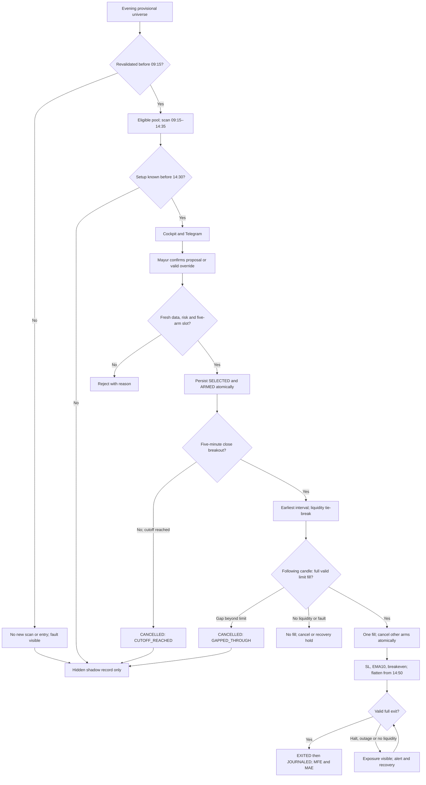

# Phase 1 design review — preview paper system

[ASSUMED: proposal] Status: DESIGN ONLY / NOT APPROVED / NOT IMPLEMENTED. D-001..017 in ../audit/DECISIONS.md are Mayur-approved intent; precise engineering choices below remain Codex proposals. No Phase 2, activation or production change is authorized by this document.
[READ_CODE] Source baseline: main 79a2d3086c8aea660dc31068e2758db1f7332808. Read current handoff plus audit packet for proposed/deployed distinctions. Actual Render state is **unverifiable by Codex**.
[READ_CODE: CI-reported] Current main test-phase-1 run 41290657216 succeeded: Python/PostgreSQL 539 passed, 3 warnings, 41.97s; both browser scripts passed. Local baseline UNKNOWN: fresh clone failed; existing directory is an unversioned mixed copy. See BASELINE_AND_REFERENCES.md.
[ASSUMED] Phase 2 gate: approved Phase 1 design plus reproducible baseline evidence for the implementation's exact starting revision. Main CI is evidence for main only, not PR15 or the mixed local copy.

## Review map

[ASSUMED: proposal] Read in this order:
1. TIME_AND_EXECUTION.md — cutoff convention, stop-limit, risk, precedence and replay correction.
2. LIFECYCLE_AND_ATOMICITY.md — transitions, five arms, DB constraints and race-test design.
3. SETUP_AND_UNIVERSE.md — exact existing rules, warm-up, hybrid publication, pool/manual catalysts/scaling.
4. JOURNAL_ALERTS_RECOVERY.md — authoritative events, shadow data, Telegram, supervision and failures.
5. BASELINE_AND_REFERENCES.md — source identity, baseline limits, test segmentation and every discovered legacy reference at pinned main.

## Fixed boundaries

[ASSUMED: approved user intent] PREVIEW_ONLY; simulated fills only; no broker order endpoint, real-money path or secret in the repository. Long only; available capital at most INR980,000; planned risk at most INR9,800 including estimated entry/exit costs and adverse stop execution; one filled entry per IST session; no leverage; at most five simultaneous arms.
[ASSUMED: proposal] Faults block new entries. Existing exposure remains explicitly OPEN/EXIT_PENDING/HALTED/RECOVERY_EXIT_PENDING until a full valid paper exit is recorded. A promise of instantaneous flat during a halt, DB outage or missing feed would conflict with D-013/D-014; never fabricate that state. A persisted manager plus independent supervisor owns each open position; loss of that ownership is a critical incident.
[READ_CODE] Conflicts requiring later implementation: held single choice, old 09:45–11:30 guards, same-day-only universe contract, replay max(open,trigger) fill/partial fills, no relational daily-fill constraint and no five-arm model. Existing indicator/ledger libraries are reusable only behind the new contract.

## Proposed versioned config envelope

[ASSUMED: proposal] Config is stored as a canonical document and SHA-256 hash, not silently changed defaults: schema_version=paper-v3-design; timezone=Asia/Kolkata; max_armed=5; max_daily_filled_entries=1; capital_cap=980000; risk_cap=9800; scan_start=09:15; scan_end=14:35; entry_cutoff=14:30; closure_deadline=15:00.
[ASSUMED: proposal] Additional proposed values: limit_buffer_pct=0.0015; limit_buffer_ticks=3; setup_ttl_minutes=15; source_close_age_max_seconds=90; quote_age_max_seconds=5; fill_participation_pct=1; adverse_slippage_bps=5; manual_membership_cap=20; review_reminder_days=30; flatten_request_time=14:50; heartbeat_seconds=30; outage_critical_seconds=600.
[ASSUMED: proposal] These are not broker-certified costs or calibrated liquidity estimates. Pin fee-model version and coefficients separately; absence of an approved/available model holds entry. No quantity rounding or client-supplied capital may bypass hard caps.
[ASSUMED: proposal] Paper outcome groups: PRIMARY (Mayur-confirmed session account) and SHADOW (independent hypothetical alternatives). Never combine their daily entry count, cash or P&L.

## Flow

[ASSUMED: proposal] Diagram describes future behavior only; it is not proof of deployed wiring.

## Numbered open questions (engineering proposals, not reopened decisions)

[ASSUMED: proposal] 1. Accept receipt-time cutoff <=14:30 and next-candle-close simulation? It conservatively excludes a usual delayed 14:25 trigger's 14:30 closing receipt; details/examples in TIME_AND_EXECUTION.md.
[ASSUMED: proposal] 2. Accept 0.15% or three ticks (larger), 15-minute setup shelf life, five-second quote freshness and the all-or-nothing conservative fill model? Approved risk/arm/time caps remain fixed.
[ASSUMED: proposal] 3. Accept the initial top-100 systematic pool plus up to twenty filtered manual catalysts, with capacity gates and reserved manager bandwidth? No afternoon performance claim.
[ASSUMED: proposal] 4. Which existing independent host can run the watchdog, and which authenticated Telegram chat receives alerts? Connection setup and any new hosting/cost require separate approval; no credentials requested in repo or design.
[ASSUMED: proposal] 5. Approve the design only after audit, then separately authorize Phase 2's pure lifecycle/replay slice. No deployment or activation is bundled.
