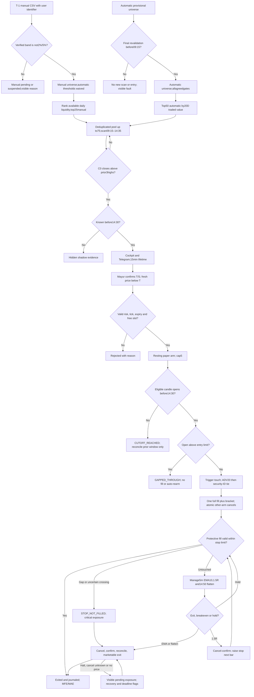

# Phase1 design review — round2 C0 resting bracket

[READ_CODE]2026-11-01:Mayur accepted the proposed IPO ranking/allocation and short-history indicator model “for now”,subject to later revision. Current policy version IPO_SHORT_HISTORY_V1 is approved as a design policy,NOT empirically validated,implemented or activated. Changes later require a new version and preserved historical lineage;no retroactive result rewrite. Mixed-history trade-tie and precise calendarT-1 mapping were not separately approved by this answer.

[READ_CODE] Latest Mayur amendment:automatic admission all agreed thresholds;manualT-1 CSV with band-only admission and persistent user identifier;capacity75=50automatic+25manual,ranked withincohorts with available daily history for short-listed IPOs. This supersedes prior shared manual filters/20cap/25-systematic proposals. See UNIVERSE_AND_POOL_CONTRACT.md;no Phase2.

[READ_CODE] Approval update2026-11-01: Mayur answered “all yes” to the five round2 questions. Approved scope: C0 filter scope/prior3 width denominator; max(T-S)/T2.5%; one-tick default T/S buffers; stop-limit rather than plain-limit; proposed override bounds and conservative low<Q stop-no-fill rule with sensitivity. This is design approval of those choices, not implementation/test proof, buffer calibration or Phase2 authorization. Other proposals remain proposed.

[ASSUMED] DESIGN ONLY, not Phase2 or a release. Mayur's strategy definition supersedes the old three-bar-range setup wherever different. Round1 following-close primary fills, receipt-based cutoff and top100 initial pool are SUPERSEDED.
[READ_CODE] Source main79a2d3086c8aea660dc31068e2758db1f7332808 reread for detector/qualifier/scanner/choice guard. Historical CI evidence remains separate from local UNKNOWN baseline. Actual Render state **unverifiable by Codex**; no deployment/config/cron change.
[ASSUMED] Single proposed Phase2 application foundation: origin/main containing PR14 HumanChoicePaperLedger; PR13/15 remain open/reference-only. No merge/cherry-pick/closure. Mayur supplies clean checkout; baseline verification and explicit Phase1 approval precede Phase2.

## IPO follow-up design

[READ_CODE] Mayur reaffirmedT-1manualentry,requested another zero-historyrankingmethod and authorized a separateIPOshort-historypolicy. See IPO_SHORT_HISTORY_POLICY.md. CSVpriority/laneallocation and newRVOL/HTFprofiles nowacceptedforcurrentpolicy,subjectrevision;no Phase2.

## Universe/pool definition review

[READ_CODE] See UNIVERSE_AND_POOL_CONTRACT.md for the two admission routes,universe/pool/setup/arm sets,approved50/25quotas,manual exceptions and identifier lineage. Exact import/timing/IPOedge details remain proposed;no Phase2 started.

## Authoritative strategy and review map

[ASSUMED: Mayur strategy] C0.close strictly exceeds highest prior3highs; qualify only at C0 close. Default proposed T=highC0+one effective tick; S=minLow(C0,prior3)-one tick. Confirm with fresh price<T to arm a resting stop-limit bracket;15min signal lifetime. Same eligible trigger candle can fill, all-or-nothing. Protective failure is STOP_NOT_FILLED/critical, not an assumed capped loss.
[ASSUMED: Mayur amendment] Fill candle START before14:30; receipt only guards stale/known evidence. Last eligible bar14:25–14:30;14:30-opening bar ineligible. Scan09:15–14:35, hidden postcutoff setups. Capacity75:50automatic plus25manual;manual liquidity rank may use<20completed sessions. Measured no-trade capacity evidence still pending.
[ASSUMED: hard constraints] PREVIEW_ONLY; no real-money/broker-order path or secrets; capital980000; planned risk<=9800 INCLUDING fees on L-Q; long-only; one filled entry/day; no leverage;<=5 arms; close by15:00 or report unresolved/late exposure honestly. Protected legacy entrypoints untouched.

| Document | Review section |
|---|---|
| [READ_CODE] SETUP_AND_UNIVERSE.md | Side-by-side change map; preserved calculations; hybrid/final universe, pool/manual/scaling |
| [READ_CODE] TIME_AND_EXECUTION.md | Signal/lifetime; exchange cutoff; resting entry; protective OHLC rule; L-Q risk/overrides/precedence |
| [READ_CODE] LIFECYCLE_AND_ATOMICITY.md | Same-candle transitions; DB invariants; stop-cancel-confirm-exit; sole implementation base |
| [READ_CODE] REPLAY_ANALYSIS_AND_TEST_PLAN.md | Historical buffer/stop/selection protocol; future mutation tests; broker-neutral pre-live checklist |
| [READ_CODE] JOURNAL_ALERTS_RECOVERY.md | Bracket journal/excess loss; MFE/MAE bounds/shadow; Telegram and independent supervision |
| [READ_CODE] BASELINE_AND_REFERENCES.md | Clone error uncertainty; clean checkout; segmented baseline; protected references/Render checklist |

## Versioned defaults, not calibrated parameters

[ASSUMED: review defaults; approved scope stated above] C0_V2_FILTERS retains C0 EMA10>EMA20, close>EMA10/EMA20/VWAP, RVOL>=1.2 and completed15m rising-EMA trend; prior3 width<=2.5% with denominator close(-1C). Tick buffers one tick beyond highC0/minLow4. These reviewed item7 defaults are now approved by Mayur; no empirical validation claimed.
[ASSUMED: placeholder] ENTRY_BUFFER_REVIEW_V2 L=ceil_tick(T+max(0.15%*T,3ticks)); STOP_BUFFER_REVIEW_V2 Q=floor_tick(S*(1-1.0%)). Final values require replay analysis, not approval by repetition. Full q risk uses L-Q+fees; L-S risk reported separately.
[ASSUMED: review defaults; approved scope stated above] Max distance(T-S)/T<=2.5%; override deltas<=max(0.10%T0,2ticks) while retaining trigger above highC0 and stop below all4 lows. Proposed candle age90s/quote age5s/participation1%/adverse slippage5bps require sensitivity review. No broker-certified charges claimed.
[ASSUMED] Hard risk/quantity/arm caps are invariants, not optimization knobs. Unfilled/halted stop can lose more than9800; no max-loss guarantee. Candle path/selection timing uncertainty is journaled, not hidden.

## Updated flow

[ASSUMED] Future behavior only, not implemented wiring.

[ASSUMED] No trigger-touch branches remain ARMED until expiry/cutoff/invalidation. Qualified but unselected/cancelled setups retain shadow evidence; no selection means no primary trade.

## Approved answers and remaining gates

[READ_CODE] All five answers approved by Mayur2026-11-01:
1. [READ_CODE] C0 EMA/VWAP/RVOL/15m filters and prior3width denominator close(-1C).
2. [READ_CODE] Maximum(T-S)/T2.5%.
3. [READ_CODE] One effective tick beyond highC0/minLow4.
4. [READ_CODE] Stop-limit entry and protective semantics, not plain limit.
5. [READ_CODE] Bounded overrides and conservative low<Q stop-no-fill primary model, with alternate sensitivity reported.
[ASSUMED] Entry0.15%/3ticks and stop1.0% remain placeholders pending real-data analysis. Candle-age90s/quote5s/participation/slippage proposals are not approved merely by these five answers. Local baseline UNKNOWN; clean checkout promised. No Phase2 approval or deployment action inferred.
